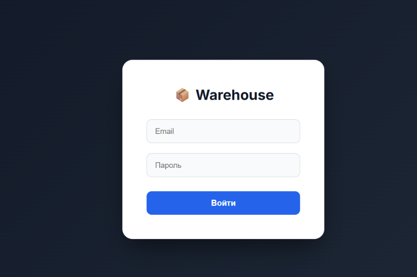
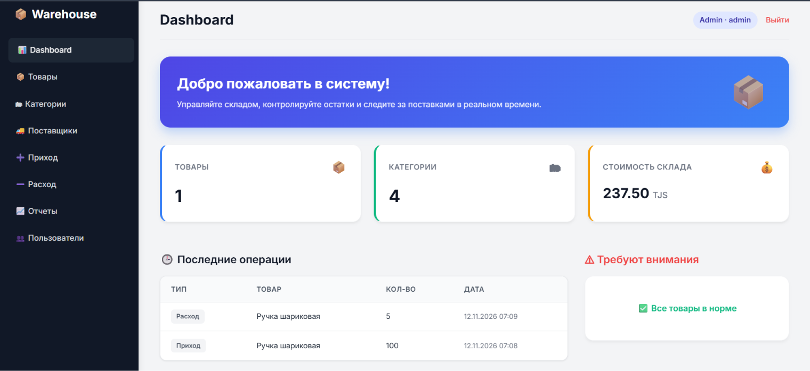
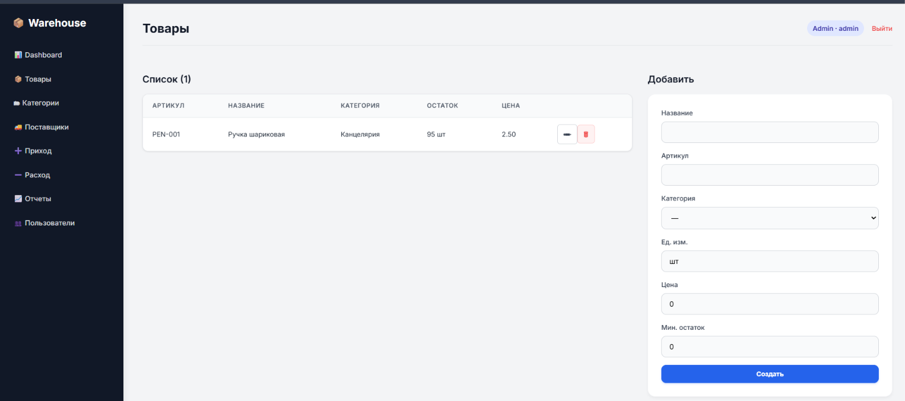

# Проектирование интерфейса (UI/UX) — Лабораторная работа №9

Интерфейс системы **Warehouse Online** разработан с упором на современность, минимализм и удобство для пользователя (UX). 

## Основные принципы дизайна:
1.  **Чистота и воздух:** Использование светлой темы, достаточного количества отступов и теней, чтобы глаза не уставали при долгой работе.
2.  **Акцентные цвета:** Основной цвет бренда — синий (#2563eb), который ассоциируется с надежностью и технологиями.
3.  **Интуитивная навигация:** Слева расположено темное меню с иконками (эмодзи), что позволяет быстро находить нужные разделы.
4.  **Обратная связь:** Все действия (сохранение, удаление) сопровождаются всплывающими уведомлениями (Toast).
5.  **Адаптивность:** Сетка сайта подстраивается под разные разрешения экрана.

## Скриншоты интерфейса

### 1. Страница авторизации

*Минималистичная форма входа с темным фоном и акцентной кнопкой.*

### 2. Дашборд (Главная страница)

*Сводка ключевых показателей, приветственный баннер, последние операции и список товаров, требующих закупки.*

### 3. Раздел «Товары»

*Таблица с товарами, кнопками управления и формой добавления в правой колонке.*